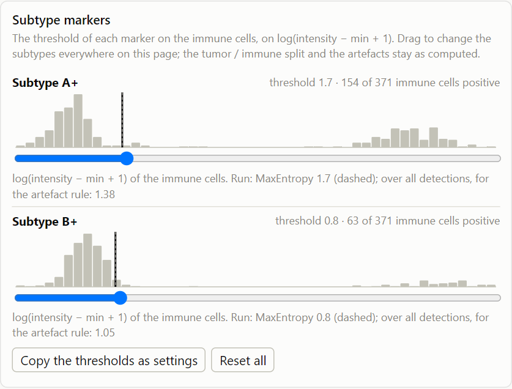

# Cell types

Every detection becomes a **tumor cell**, an **immune cell** with its **subtype**, or an **artefact**, in two steps:
first the lineage, tumor or immune; then, for the immune cells, the subtype markers.

## Tumor or immune cell

The cells are split into two groups by k-means clustering on three values per cell: the tumor marker, the immune
marker (both normalized, on a log scale) and the area. The group with the lower immune/tumor marker ratio is the tumor
cells. This is the classification of the Fiji macro v1.8.

??? note "Technical: the clustering"

    Features: log(immune intensity), log(tumor intensity) and area, each scaled to mean 0 and SD 1 (sample SD).
    k-means with 2 clusters, 10 starts, seed 48 (the macro's seed; scikit-learn's k-means is not bit-identical to
    ImageJ's, but on well-separated data the result is the same: 100 % agreement on the validation data). The tumor
    cluster is the one with the lower **sum** of *marker ratio over area*, as the macro computes it (its comment says
    average; with clusters of unequal size the two can differ).

    Several immune markers are summed after normalization, so the immune side can be defined by a panel (for example
    CD3 and CD56) instead of one marker.

## Immune subtypes

Each **subtype marker** gets a threshold: an immune cell above it is positive for that marker. The combination of
positive markers is its subtype, named after them: *Subtype A+*, *Subtype A+ Subtype B+*, or *negative*. The
thresholds are automatic, or set by hand (`classification.thresholds`, or with the sliders in the
[dashboard](../guide/dashboard.md#subtype-markers)).

*Threshold of the subtype markers*:

- **MaxEntropy** (default, as ClassifyCellTypes 2.8): finds the split of the histogram with the most information on
  both sides; suited to a large negative population with a positive tail.
- **MaxEntropy strict**: the MaxEntropy threshold, raised where needed so that it lies at least two robust standard
  deviations above the middle of the negative cells. Fewer false positives, a few more missed positives.
- **Otsu**: the split that best separates two populations of similar size.

{ width="420" }

??? note "Technical: the thresholds"

    Intensities of markers are roughly log-normal, so the threshold is found on

    $$x = \ln(v - \min v + 1)$$

    of the background-subtracted cell means *v*, with ImageJ's auto-threshold on a 256-bin histogram of *x* (as
    `setAutoThreshold("MaxEntropy dark")` in 2.8), and transformed back: $t = e^{t_x} - 1 + \min v$. A cell is positive
    when *v* > *t*. The MaxEntropy, Otsu, Yen and RenyiEntropy methods are ported from ImageJ's AutoThresholder and
    give the same thresholds as Fiji (checked to 10⁻¹¹).

    **The thresholds are computed on the immune cells only.** A subtype marker may also be expressed by tumor cells;
    thresholding it within the immune cells keeps them from shifting the threshold.

    **MaxEntropy is liberal.** It cuts in the upper tail of the negative population, so some negative cells (on
    synthetic log-normal data typically 10–20 % of them, depending on how far the populations lie apart) are called
    positive. *MaxEntropy strict* roughly halves that for well-separated markers. `Marker thresholds.tsv` and the
    histograms in the dashboard show where each threshold lies; check them, and set a threshold by hand where the
    automatic one is clearly off.

??? note "Technical: why two steps, and not one clustering of all cells"

    One k-means of all cells into k types was considered and not used: k-means favours groups of similar size and
    spread, so a small subtype is absorbed by a large neighbour; k must be chosen in advance; and the clusters must be
    named afterwards. A threshold per marker can be read, checked on its histogram and changed, and the combinations
    of positive markers name the subtypes directly.

## Artefacts

A detection that is positive in **all** subtype markers (with two or more of them) is not taken to be a cell but an
**artefact**, for example debris or a dead cell that takes up every dye. Artefacts are left out of the tumor/immune
clustering, drawn in grey, and not counted as cells in the counts and the interfaces. *Artefact: positive in at least N
subtype markers* sets another number; 0 switches the rule off.

??? note "Technical: the artefact rule"

    For this rule each subtype marker is thresholded over **all** detections (not only the immune cells, which are
    not known yet), before the clustering. `Positive markers` in the cell table holds the count;
    `Marker thresholds.tsv` lists both thresholds of each marker ("all cells" and "immune cells").

    Because the automatic thresholds are liberal, a few real cells are positive in several markers by chance and
    become artefacts: in the synthetic example data, about half as many again as the artefacts that were drawn. A
    stricter threshold, or a threshold set by hand, reduces that.

    Only the subtype markers count. Counting the tumor and immune markers as well (a detection bright for both could
    be two cells drawn as one) was tried and dropped: an automatic threshold of those markers over all detections
    calls far more cells positive than the clustering finds, so most detections would become artefacts.

## Several datasets: pools

With **Classify together** = *experiment* (the default), the cells of all datasets with the same experiment label are
classified together: one clustering and one set of thresholds. A cell that is "Subtype A+" is then positive by the
same standard in every dataset of the experiment, so the subtype fractions can be compared between datasets. With
*dataset*, each dataset gets its own thresholds.

??? note "Technical: when to pool"

    Pool datasets that were stained and acquired alike (an experiment). Each dataset keeps its own background and its
    own normalization of the tumor and immune markers; only the clustering and the thresholds are shared. Datasets of
    different staining batches or instrument settings can differ in brightness: give them different experiment
    labels, or classify per dataset. The run then measures all datasets first, classifies each experiment, and
    finishes each dataset; `run.json` says what a dataset was classified with.

## Colours

The dashboard colours up to eight cell types apart (tumor, up to six immune types, artefacts), in a fixed order so that
a type keeps its colour when others come and go. More immune types share a grey; the legends and tables always name
the types.
