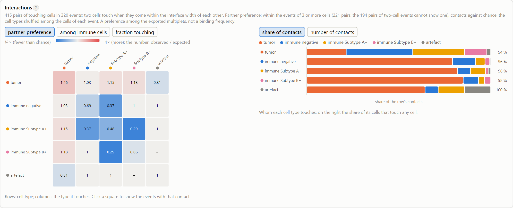
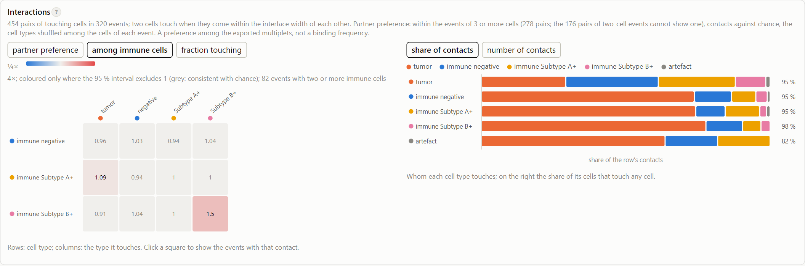

# Cell contacts

## Which cells touch

Two cells in the same event **touch** when one of them lies within *Membrane / interface width* of the other. If this
setting is left empty (the default), the width is about 1.5 µm, which is 2 px at 20×, 3 px at 40× and 5 px at 60×.
This is the same distance that defines the [interfaces](membrane.md), so a cell with an interface always lists its
partner among the cells it touches. Cells in different events never touch.

For every cell, the column `Touching (labels)` lists the cells it touches, and `Neighbour types` lists their cell
types. For every event, the column `Interactions` gives the number of touching pairs.

??? note "Technical: the distance"

    "Within *k* pixels" means within *k* steps between 4-connected pixels. This is the reach of the dilation that
    makes the interfaces (done with CLIJ2 in the macro). Two cells with no background pixel between them are 1 step
    apart; two cells with a gap of *g* pixels between them are *g* + 1 steps apart. ClassifyCellTypes 2.8 used the
    region adjacency graph of MorphoLibJ on the shrunk labels, which counts only cells that touch directly. Here, cells
    that almost touch also count, as they do for the interfaces.

    The default is set in µm rather than in pixels, so that "touching" means the same at every magnification. The
    width in pixels is the whole number nearest to $1.5\,\mu\mathrm{m}$ / pixel size, with a minimum of 2. A fixed
    width of 3 px would mean 3 µm at 20× (so that near misses would count as contacts) and 1 µm at 60×. If you set the
    width in pixels, that value is used as it is.

## Counting contacts

`Interactions.tsv` and the [dashboard](../guide/dashboard.md#interactions) give, for each cell type (row) and each
cell type it touches (column):

- **contacts**: the number of touching pairs. A pair of an A cell and a B cell counts once in row A and once in
  row B.
- **cells touching**: the number of cells of the row's type that touch at least one cell of the column's type, and
  the **fraction** of the row's cells that this represents.

## Partner preference: contacts compared with chance

The plain counts mostly reflect how many cells of each type there are. To see whether some cell types **prefer** each
other, the observed contacts are compared with chance. The expected number of contacts is the number you would get if
the cell types were shuffled among the cells of each event, while the cells in every event and the number of contacts
in it stay as they are. The ratio **observed / expected** is above 1 when two cell types touch more often than random
pairing of the cells within their events would give, and below 1 when they touch less often.

**Only events with three or more cells are used.** In an event of two touching cells, the pair can only be the pair
it is, so observed and expected are equal by construction, whatever the biology. Such events would pull every ratio
towards 1. They are therefore left out of this comparison, although they still count in the plain contacts. The
dashboard shows how many pairs remain.

??? note "Technical: the expected contacts, exactly"

    No random shuffling is done: the expected number is computed exactly. Take an event of *n* cells, of which $c_A$
    are of type A. A given touching pair in that event consists of an A cell and a B cell (A ≠ B) with probability

    $$p_{AB} = \frac{2\,c_A\,c_B}{n\,(n-1)}$$

    and of two A cells with probability $c_A (c_A - 1) / (n (n-1))$. The expected number of contacts of A with B is
    the sum, over all events of three or more cells, of (number of pairs in the event) × $p_{AB}$. It is counted from
    both sides, in the same way as the observed contacts (so an A–A pair counts twice). As a result, the page and
    `Interactions.tsv` give identical numbers. Pairs of cell types that never touch, but would touch by chance, also
    get a row, with 0 observed contacts: this indicates avoidance.

    The total of the expected contacts equals the total of the observed contacts: chance only redistributes the
    contacts over the cell types.

### What the selection in IDEAS means

The export contains only the objects that were selected in IDEAS. Often these are only multiplets, without single
cells, and sometimes only events that contain both cell types. The comparison with chance takes into account which
cells are in each event, because it shuffles only within an event. It does not take into account *why* an event was
exported. The question it answers is therefore:

> Within the exported multiplets of three or more cells, which cell types touch each other more, or less, than random
> pairing of the cells in their events would give?

A selection on **which cells an event holds**, such as a gate on tumor-marker and immune-marker intensity (both
colors present), therefore does not bias the ratio: the ratio already takes each event's cells as given. A selection
on **the contact itself** does: a gate on an interface or synapse feature, or on a shape that favors one arrangement
of the cells, builds the preference for that contact into the export. Datasets compared with each other need the same
gates.

It does **not** answer how often immune cells bind tumor cells in the sample. That would need the cells that never
touched another cell (the singlets) and the events without contacts, and these are not in the export. A conjugate
frequency (for example "the percentage of T cells in conjugates") can only be computed from an export that keeps all
events, including the singlets.

??? note "Technical: further limits of the null model"

    - The model assumes that every pair of cells in an event is equally likely to touch. In reality, a large cell has
      more room for neighbors than a small one. In an event with one large cell and several small ones, the large cell
      therefore takes part in more contacts than chance predicts. Comparing the same cell types between conditions is
      safer than interpreting a single ratio on its own.
    - Small numbers give large ratios. A ratio of 2 based on 2 observed contacts and 1 expected contact means little.
      The tooltip in the dashboard and the table both give the counts, so check them.
    - Artefacts take part in the comparison like any other cell type. With a stricter artefact rule, cells move from
      the artefacts to the cell types, and the other way round with a looser rule.
    - In tests without any preference, *tumor–tumor* came out at about 1.5, because larger cells have more neighbors.
      Real preferences, on the other hand, come out weaker than they are. In one test, a subset that was placed next to
      tumor cells far more often after a treatment rose only from 1.03 to 1.11, although it did so consistently in both
      donors. So compare datasets (donors, conditions) with each other, rather than comparing a single ratio with 1.

## Subset preference: which immune cells touch

The partner preference above shuffles all cell types. It therefore compares tumor cells with immune cells, which differ
in size. For the immune subtypes, a cleaner question can be asked: **when an event offers a choice of immune cells, is
the immune cell that touches the tumor cell (or another immune cell) of this subtype more often than chance would
predict?** To answer this, only the subtypes are shuffled, among the immune cells of each event. The cells, their
positions, the tumor cells and the contacts all stay as they are. Only events with at least two immune cells are used,
because with a single immune cell there is no choice.

The result is the ratio observed / expected for each subtype and each partner (tumor cells or an immune subtype), with
a **95 % interval**. No interval is given when fewer than 5 contacts are expected. In the dashboard (*Interactions*,
tab *among immune cells*), only the squares whose interval excludes 1 are colored. Because many squares are tested at
once, about one square in twenty will exclude 1 by chance alone. Trust a preference that is found in every dataset
(donor, replicate), not a single square. The results are in `Subset preference.tsv` for each dataset and in
`subset preference.tsv` in the project folder.

??? note "Technical: the subset preference, exactly"

    **Expected.** Take an event with *n* immune cells, of which *cS* are of subtype *S*. When the subtypes
    are shuffled among these cells, every immune cell has subtype *S* with probability *cS* / *n*. Each
    immune–tumor contact in the event therefore involves a cell of subtype *S* with that probability. Each
    immune–immune contact involves subtypes *S* and *T* with probability 2 *cS* *cT* /
    (*n* (*n* − 1)), or two cells of subtype *S* with probability *cS* (*cS* − 1) /
    (*n* (*n* − 1)); these are counted from both sides, as in the contact table. The expected number of contacts is
    the sum of these probabilities over the contacts of all events with *n* ≥ 2. The observed number is the number of
    contacts counted in the same events (`contacts`). Artefacts are not included, and tumor cells are never shuffled.

    **The interval.** The events are resampled with replacement (as many events as there are), observed and expected
    are summed again, and the ratio observed / expected is recomputed. The 2.5th and 97.5th percentiles of this ratio
    over the resamples form the interval. Python uses 1000 resamples with a fixed seed, so that the tables are
    reproducible; the page uses 400, so its interval is slightly different. The interval reflects the sampling of
    events within one dataset, not the variation between donors; compare datasets for that. Below 5 expected contacts
    no interval is given. A resample of only a handful of contacts often contains the same contacts every time, which
    gives an interval of zero width that excludes 1 on the basis of one or two contacts.

    **Why within events.** Shuffling the subtypes over the whole dataset asks whether a subtype is over-represented
    among the immune cells that touch tumor cells. In an export of conjugates, nearly every immune cell touches a tumor
    cell (95 % in the example data), so that ratio can hardly exceed about 1.05, whatever the biology. Within an event
    that offers a choice, it can. In the example data, cells of Subtype A+ were placed next to the tumor cell more
    often. The dataset-wide version gave 1.00 (0.93–1.08), and the within-event version 1.09 (1.03–1.17). The effects
    are small in both versions because most events offer little choice: when an event has one tumor cell and two immune
    cells, both immune cells usually touch it.

    **What it does not correct for.** A subtype that is larger, or that is more often segmented as two cells, still
    touches more often. The subtypes are assumed to be of similar size. The limits of the selection in IDEAS, described
    above, apply here too.

## Comparing conditions

The **experiment** label does two things. Datasets with the same label are classified together, with one threshold
per marker (see [pools](classification.md#several-datasets-pools)), and the overview adds them up into one
partner-preference matrix. To compare, for example, control and treated samples that were stained in the same way:

- Give them **one** experiment label, so that "positive for A" means the same in both (or set the thresholds by hand).
- Give every dataset its **condition** and its **replicate** (donor). The overview then tests the change in subset
  preference across the donors, with an interval and a correction for the number of pairs tested; see
  [Comparing conditions](comparing-conditions.md). The overview's matrix for each experiment pools the conditions, so
  it cannot show a change.
- Expect **small numbers**. Few events give the immune cells a choice, so real changes in preference come out weak.
  In a test where a subset was placed next to the tumor cell more than twice as often after treatment, the ratio rose
  by 0.05–0.25. In a simulation with the event geometry of real data, it rose by about as much: the tool cannot recover more than the
  events contain. How many donors and events are needed to detect such a change is described in
  [Comparing conditions](comparing-conditions.md#technical-calibration-by-simulation).

## Multiplets

`Multiplets.tsv` counts the events with *n* cells and the events with *n* contacts (*n* = 0, 1, 2, …), like the
*multiplets* table of ClassifyCellTypes 2.8.
