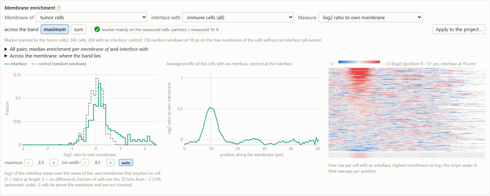
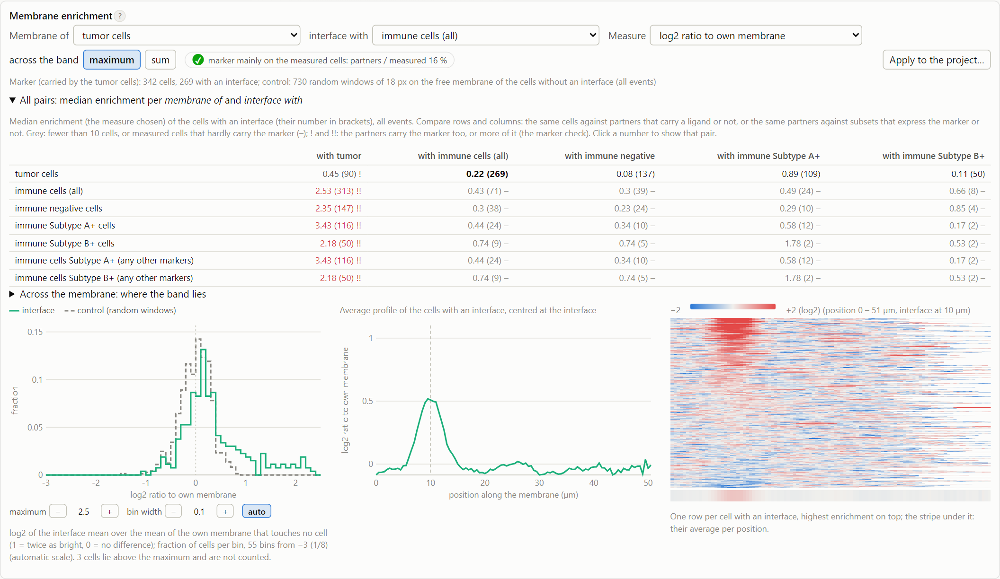

# Membrane enrichment

This analysis asks whether a marker of interest is enriched in the membrane of one cell type at the places where it
touches another cell type, compared with the rest of its membrane. Tick *Membrane profiles and enrichment* to switch
it on. With several markers of interest, the analysis is done for each of them (see
[Several markers of interest](#several-markers-of-interest)).

## The membrane profile

For every cell, the outline is traced, smoothed and **straightened**. The marker of interest is sampled in a band
across the membrane, and at every position along the outline the brightest sample across the band is kept. The width
of the band is set by *Straightening width*; by default it is about 4.5 µm, which is 5 px at 20×, 9 px at 40× and
13 px at 60×. The result is a background-subtracted profile along the membrane, with one value per pixel of perimeter.

By default the band is **centred where the membrane lies**, not on the outline (*Band centred on*: *membrane*). The
outline that Cellpose draws does not lie on the membrane: where a cell is free it usually lies outside the stained
membrane, and where cells touch it lies on the boundary between their masks, which need not be the membrane either.
The program therefore first finds the membrane in the data, for each cell type, at the free membrane and at the
contacts with each cell type, and moves the band there. See
[Where the membrane lies](#where-the-membrane-lies-and-a-false-enrichment-it-prevents).

Along the same line, every position also records whether another cell lies within the interface width, and if so,
which cell. This record is the cell's **neighbor track**.

??? note "Technical: one membrane per cell"

    The Fiji macro straightened one ring for each blob of touching cells of the same type. Here every cell has its own
    membrane, so two touching tumor cells give two membranes. The outline follows the pixel edges (marching squares)
    and is smoothed with a Gaussian (σ = 2 samples), where Fiji fits a spline; it is then resampled at 1 px. At every
    pixel of the cell that lies within the interface width of another cell, the neighbor track stores the label of the
    nearest other cell. The length of every profile is stored, so a value of 0 is data and does not mark the end of the
    profile (in the macro, zeros ended it).

### Where the membrane lies, and a false enrichment it prevents

Where a cell is free, the outline that Cellpose draws lies a little **outside** the stained membrane (by about 1 µm in
the tests, after *Shrink cells*). Where two cells touch, it lies on the boundary between the two masks, which is
close to the membrane. A band centred on the outline then reaches less of the free membrane than of an interface. If
the band is too narrow, the brightest sample at the free membrane misses part of the membrane, while at a contact it
does not, and the interface looks enriched for any membrane marker, without any biological cause.

**How the membrane is found.** For every measured cell, the marker of interest is sampled across the outline, 3 µm
to each side, and averaged along the free membrane and along the contacts with each cell type. These profiles are
averaged over the cells of each type. Their peak is where the membrane lies, relative to the outline. The band is
then centred there: at the free membrane on the free peak, at a contact on the peak for contacts with that cell type,
with a smooth transition where a contact begins or ends. The neighbor track is still taken on the outline.

- The membrane of a cell type is located with a marker of interest that this cell type carries: its median
  whole-cell intensity is at least half that of the brightest cell type, so a marker on both types locates both. A
  marker that a cell type does not carry shows no membrane of that cell, or signal elsewhere in it. With several
  markers carried by the same type, the one most specific to that type is used (then the one with the clearest
  peak), and its place holds for all markers (the membrane is where it is, whatever the marker).
- If no marker of interest is carried by a cell type, if fewer than 20 cells contribute, or if the average has no
  clear peak, the band stays on the outline there. The log says so.
- One place per cell type, not per cell: the single cells scatter around it, and the average is far more robust
  than a peak in each cell, which would also let the marker choose its own band.

**The check.** The log of every run says, for each cell type and place, where the membrane lies (in µm from the
outline, + is outside) and how much single cells vary (the middle half). `Membrane location.tsv` holds the same per
marker, and `Membrane location - profiles.tsv` the average profiles. The dashboard's membrane card shows them under
*Across the membrane*. With the band on the outline (*Band centred on*: *outline*, as the macro), a warning is logged
when the band does not reach at least a pixel beyond a membrane.

On real data, the place of the membrane differed between the cell types, and between the free membrane and the
contacts: for one cell type the outline lay outside the membrane everywhere, so a band on the outline was fair; for
the other it lay outside at the free membrane but beyond the membrane at contacts, so a band on the outline
favoured the interface. Single cells also varied by about as much as these distances. A wide band (the default
4.5 µm) still matters: centring removes the systematic difference between free membrane and interface, and the
width takes up the variation between cells.

??? note "Technical: the straightening width with the band on the outline"

    In a test at 40× (0.5 µm per pixel), with the band on the outline, a ligand on the tumor membrane was enriched
    only where Beta+ immune cells touched. The tumor cells' interface with Beta− cells, which has no enrichment,
    measured:

    | Straightening width | Beta− contacts (truth: none) | Beta+ contacts (truth: enriched) |
    |---|---|---|
    | 5 px (2.5 µm; the macro's value) | 1.4–1.6 SD, ratio 1.31 | 7.2–7.5 SD, ratio 2.5–2.65 |
    | 9 px (4.5 µm) | 0.35 SD, ratio 1.05 | 6.5–6.7 SD, ratio 1.95–2.0 |
    | 13 px (6.5 µm) | 0.2 SD, ratio 1.03 | 6.6–7.1 SD, ratio 1.9 |

    The default is therefore about 4.5 µm: the odd number of pixels nearest to $4.5\,\mu\mathrm{m}$ / pixel size,
    with a minimum of 5. A wider band somewhat lowers the ratio of a real enrichment, because the free membrane is now
    measured at its true brightness, but the real enrichment stays clearly separate from the false one. If you set
    the width in pixels (`membrane.straightening_width`), that value is used as it is. The comparison with the Fiji
    macro uses the macro's 5 px, with the band on the outline. With the band centred on the membrane (the default),
    the result depends much less on the width: in a synthetic test with an evenly stained membrane, a 3 px band on
    the outline made the interface look about 30 % brighter than the free membrane, and centred on the membrane both
    3 px and 9 px gave no enrichment.

    A wider band also reaches further into a touching partner. This matters only when the partner carries the marker
    (see [Where the marker is expressed](#where-the-marker-is-expressed)).

## A pair of cell types

**Membrane of** and **Interface with** choose the pair of cell types. Each can be:

- a cell type (*Tumor*, *Immune*);
- an immune subtype as it is named in the tables (*Immune Subtype A+*, or *Immune negative* for the immune cells that
  are negative for every subtype marker);
- a marker (*Subtype A+*: every immune cell that is positive for that marker, whatever its other markers).

Anything else (for example *Immune Subtype A* without the +) stops the run before it starts, with a message that
suggests what was probably meant.

If *Membrane of* is left empty, the measured cells are the cell type that **carries the marker**: the tumor cells or
the immune cells, whichever has the brighter membrane. This is decided from the data, for each marker of interest
separately. If *Interface with* is left empty, the partners are the other cell type. Every marker of interest has
a pair of its own, and each side is set on its own: a marker can, for example, be measured on the tumor cells
against *Subtype A+* cells, and another one on the *Subtype A+* cells against the tumor cells. In the [dashboard](../guide/dashboard.md#membrane-enrichment) you can change the pair
directly.

The log says which cell type carries each marker. In the example (Donor 1): "Marker: carried by the tumor cells (medians
tumor 31.64, immune 4.478, membrane that touches no cell): membranes of Tumor with Immune". The same is recorded in `run.json`
(*markers of interest*), in the column *marker on* of `Membrane pairs.tsv`, and in the overview column *MOI on* of each
marker.

??? note "Technical: how the carrying cell type is decided"

    The measure is the one of the [marker check](#where-the-marker-is-expressed): the median free-membrane intensity,
    background-subtracted, of the tumor cells and of the immune cells (all immune cells together, whatever their
    subtype). The type with the higher median carries the marker. Without the membrane analysis, the mean intensity of
    the whole cell is used instead. Before November 2026, this choice was a setting (*Marker of interest expressed in*).
    A settings file or project that still has it (`channels.cell_of_interest`) loads without an error; the setting is
    ignored, and the log says so.

    Because the default pair always measures the brighter type, the marker check of that pair cannot show "brighter on
    the partners". It can still show that the partners carry part of the marker, or as much of it.

For the measured cells, the **interface** is the part of the membrane where the neighbor track shows a partner. The
**free membrane** is the part that touches no cell at all.

## The enrichment

For every measured cell that has an interface, the analysis reports:

- **interface Mean** and **non-interface Mean**: the mean of the profile at the interface and on the free membrane,
  and the ratio of the two;
- **stdDevs above mean**: how far the interface lies above the free membrane, expressed in standard deviations of the
  free membrane:

$$\text{SD above mean} = \frac{\overline{\text{interface}} - \overline{\text{free}}}{\text{SD}(\text{free})}$$

The profiles are normalized in the same way, and aligned so that the center of the longest interface of each cell lies
at position 20. Their average, over the cells with an interface only, shows the shape of the enrichment.

??? note "Technical: why the free membrane is the baseline"

    The macro compared the interface with the rest of the membrane, including the parts that touch other cells. A
    contact with another cell that carries the marker (for example between two tumor cells, when the marker is on tumor
    cells) places two membranes side by side and is therefore brighter. It would raise the baseline and lower the
    enrichment. Here the baseline is the membrane that touches no cell. On validation data, this raised the median
    enrichment by about 0.2 SD, while the control stayed the same.

## The control

Cells without an interface get **control windows**: *Control windows per cell* (default 10) windows at random positions
on their free membrane. Each window is as long as the median interface and is scored like an interface. The histogram
of the controls shows how much a stretch of free membrane varies by chance in this dataset.

Both histograms (in the dashboard and in the files `Histogram_interface_stdDevs_above_mean - <marker>.tsv` and
`Histogram_control_stdDevs_above_mean - <marker>.tsv`) start at −5 SD and share one scale. If *Histogram maximum* and
*Histogram bin width* are left empty, the scale is automatic. The maximum is the 99th percentile of the interface
values or of the control windows, whichever is higher, but at least 5 SD, and it is rounded up to a whole number of
bins. The bin width is the smallest of 0.1, 0.2, 0.25, 0.5, 1, 2.5, 5, 10, and so on, that gives at most 60 bins.
Values above the maximum are not counted. You can change the scale in the dashboard without running the analysis
again.

**The control windows are not a control for the interface itself.** Because they lie on free membrane, they cannot
show what the contact does to the measurement, independently of the marker. A contact can change the measurement in
several ways: two stained membranes lie side by side (see below), the outline runs a little outside the membrane where
the cell is free but not at a contact, and the partner's signal blurs into the interface. In a test on synthetic data
without any enrichment, the outline effect alone gave a ratio of about 1.3 and 1–1.5 SD with the macro's
straightening width, and very small p-values against the control windows. The default width now removes most of this
effect (see the technical note on the straightening width), but not the other effects. Therefore:

- **Compare pairs**, not an interface with the control windows. Compare the same measured cells with partners that do
  carry a receptor or ligand and with partners that do not (for example *Immune A+* against *Immune negative*). Or
  compare cells in which you expect the marker to be enriched with cells of the same type (set *Interface with* to
  the measured type itself). The dashboard shows all pairs at once (*All pairs* in the membrane card). In the example
  below, the tumor cells' membrane is enriched only at contacts with *Subtype A+* cells.

- A small shift (a ratio below about 1.5, or 1–2 SD) is within what geometry alone can produce; a large effect that
  is specific to one pair is not.
- Check in the dashboard that the outlines lie on the membrane (*Events*, overlay *outlines*).
- A p-value from thousands of cells against thousands of windows says nothing about biological replicates. Compare
  datasets (donors, replicates) instead. A change between conditions is tested across the donors in the overview; see
  [Comparing conditions](comparing-conditions.md).

??? note "Technical: comparing pairs, and why there is no reference channel"

    **The pair table.** For every selection under *Membrane of* (rows) and every cell type or subtype under
    *Interface with* (columns), the dashboard computes the median *SD above mean* of the measured cells that have an
    interface with that partner, and the number of such cells. The median is computed exactly as for the chosen pair,
    but without the control windows. A pair in which the measured cells or the partners do not carry the marker is the
    geometry-matched control for a pair in which they do: the same cells, the same kind of contact and the same
    segmentation. Contacts between cells of the same type are the control for two stained membranes side by side:
    their enrichment shows what the doubling alone produces. Each entry carries the marker check of its pair: "!" when
    the partners carry part of the marker or as much as the measured cells, "!!" when they carry more, and "–" when the
    measured cells hardly carry it.

    **No reference channel.** A second channel, measured like the marker of interest but not expected to be enriched,
    seemed a natural control. The cells' own tracker dye was tested as such a reference in the 40× test described
    above. Because the dye is cytoplasmic, it fills the band at a contact but not at the free edge, and it showed 4.8 SD
    (at 5 px) and 2.7 SD (at 9 px) of "enrichment". A reference must be stained in the same way as the marker (a
    membrane stain on the same cells), which a panel rarely includes. The pair comparison needs no extra channel.

??? note "Technical: the control windows"

    The windows are drawn on the free membrane only, which is read as one closed line, and each window is scored
    against the rest of that free membrane. The macro used one window of 25 px per membrane; many windows of the
    typical interface length give a better estimate of the null distribution. The windows are random and not seeded,
    so the control differs slightly from run to run (the dashboard uses a fixed seed). All windows are listed in
    `Control windows stdDevs above mean - <marker>.tsv`.

## Where the marker is expressed

**The marker of interest must be on the measured cells, not on their partners.** At an interface, the membranes of the
two cells lie against each other. If the partner also carries the marker, its membrane is measured together with that
of the measured cell, and the interface looks enriched even when both cells are stained evenly.

The analysis checks this. It compares the median free-membrane intensity of the partners with that of the measured
cells. The result is reported in the log, in `run.json`, in the overview (*MOI partners / measured*) and as a badge in
the dashboard:

| Partners / measured | Badge | Meaning |
|---|---|---|
| below 25 % | ✓ green | The marker is mainly on the measured cells. |
| 25–80 % | ! amber | The partners carry part of the marker, so part of the interface signal may come from them. |
| 80–125 % | ! amber | The marker is on both cell types at a similar level. Two stained membranes side by side look like enrichment; compare with contacts between cells of the same type. |
| 125 % or more | ! red | The marker is brighter on the partners. Check the pair (*Membrane of*, *Interface with*). |
| (any) | – gray | The measured cells hardly carry the marker (below 25 % of the brightest cell type), so their enrichment is not informative. |

??? note "Technical: the marker check, exactly"

    Every cell gets a **free-membrane intensity**: the mean of its straightened profile where its neighbor track shows
    no cell (background-subtracted). Without the membrane analysis, the mean of the whole cell is used instead.
    *Measured* and *partners* are the medians of this intensity over the cells of each selection. The **brightest cell
    type** is the highest median over the cell types and immune subtypes, excluding artefacts. The rules are applied
    in this order:

    1. partners / measured ≥ 125 %: brighter on the partners (red);
    2. measured below 25 % of the brightest cell type: not informative (gray);
    3. 80–125 %: on both (amber);
    4. 25–80 %: the partners carry part (amber);
    5. below 25 %: mainly on the measured cells (green).

    These limits are rules of thumb. At 25 %, the partner adds a quarter of the measured cell's membrane signal to
    every interface pixel it reaches. At 80–125 %, an interface between two equally stained membranes looks like a
    doubling, whatever the biology.

If the badge is amber or red, you can choose the pair the other way round (if the marker is on the partners), compare
the enrichment with that of a pair whose partners do not carry the marker, or treat the result as an upper limit.

**Look at the subsets, on both sides.** The default pair (all cells of the type that carries the marker, with all
cells of the other type) can hide an effect that only one subset shows. In one test, a receptor that was strongly
polarized on *A+* immune cells gave a median of only 0.2 SD over all immune cells, and a ligand that was enriched only
where *B+* cells touched gave 0.7 SD with all immune cells. The *All pairs* table in the dashboard and
`Membrane pairs.tsv` give every combination of *Membrane of* and *Interface with* at once. Read them before you conclude
that there is no enrichment.

??? note "Technical: the excess over both membranes, and why it is no cure either"

    At an interface the band holds both membranes, which lie closer together than the resolution. If the
    background-subtracted intensities of the two membranes simply add, a partner that carries the marker can be
    corrected for by subtracting its own membrane as it is elsewhere. For every measured cell with an interface:

    $$\text{excess} = \frac{\overline{\text{interface}} - \overline{\text{free}} -
    \overline{\text{partner free}}}{\text{SD}(\text{free})}$$

    Here *partner free* is, at every interface position, the mean free-membrane intensity of the partner cell that
    touches there (the same per-cell value as the [marker check](#where-the-marker-is-expressed)), averaged over the
    interface. It equals *SD above mean* minus that average divided by SD(free). A partner without any free membrane
    is left out of the average; if no partner of the cell has a free membrane, the excess is empty. The control
    windows have no partner, so their excess is the control itself: the same null distribution. The membrane table
    has the excess in the column `excess stdDevs above both membranes`, the average profile in the column
    `excess profile`, and `Membrane pairs.tsv` the median per pair (`median excess above both membranes`). The
    dashboard shows it with *Measure: SD above both membranes*.

    **How to read it.** A positive excess means more marker at the contact than both membranes carry elsewhere. It
    says nothing about which of the two cells holds it. If the band captures only part of the partner's membrane, the
    correction subtracts too much: it is conservative, and can hide an enrichment but not invent one.

    **The assumption does not always hold.** The profile is the brightest sample across the band, and two membranes
    that are blurred together give a peak that is lower than the sum of their two peaks unless they coincide. In a
    simulation with thin membranes that touch exactly (`tools/stats/simulate_excess.py`), the excess of two evenly
    stained cells without enrichment was close to 0, where *SD above mean* was clearly positive. On real data, however,
    contacts between cells of the same type (where both carry the marker and no enrichment is expected) gave a
    clearly negative excess: there the correction subtracts more than the partner adds. The dashboard's switch
    *across the band: sum* adds all samples across the band instead of taking the brightest, which does add two
    membranes up; on real data it brought the same-type contacts much closer to 0, though mostly still below it.
    Check this on your own data in the *All pairs* table, with the contacts between cells of the same type (with
    either projection), before you read the excess of another pair. The comparison of conditions uses *SD above
    mean* with the maximum.

??? note "Technical: inside only, and why it is no cure"

    *Straighten inside the measured cell only* takes the brightest sample only from the part of the band that lies
    inside the measured cell, so that the band does not reach into the partner. This is a **sensitivity test, not a
    separation**. Touching membranes are nanometers apart, far below the resolution of the ImageStream, so the blur
    mixes both membranes in every pixel near the interface, whichever pixels are sampled. If the enrichment drops
    clearly with *inside only*, part of it comes from the partner side. If it stays the same, that is reassuring but
    not proof.

    *Inside only* can also cut away the measured cell's **own** membrane at a contact: the boundary between two
    masks need not lie on the membrane, and on real data the measured cells' membrane at a contact lay partly on the
    partner's side of it. A drop with *inside only* is therefore not by itself proof that the signal came from the
    partner. *Across the membrane* in the dashboard shows where the membrane lies at the contacts.

## Several markers of interest

You can tick more than one channel as *MOI* on the import page (`channels.marker_of_interest` is a list). Every marker
of interest is analyzed in the same way, on the same outlines and neighbor tracks. Each marker gets its own pair: by
default, the cell type that carries that marker against the other type. A marker on the tumor cells and a marker on
the immune cells are therefore each measured on the cells that carry them.

All markers of interest are treated alike, also when there is only one: the name of the marker is part of the names
of its files and columns. The membrane files get " - " and the name before the extension, for example
`Membrane intensity analysis - Marker.tsv`. The per-event columns and the overview columns get the name in brackets,
for example `mean tumor interface (Marker)`. `Membrane pairs.tsv` stays one file, with the marker in its first column.
See [The output folder](../guide/output-folder.md).

In the dashboard, the menu *Marker* in the membrane card switches between the markers. The comparison of conditions
tests each marker separately (see [Comparing conditions](comparing-conditions.md)).

## The per-event table

Independently of the profiles, every event gets the mean of each marker of interest at the interface and on the rest
of the membrane, for each cell type. These values are in `All cell combinations.tsv`, and for the events with
one tumor cell and one immune cell also in `Single Tumor Single Immune cell.tsv`, as in the macro. They are measured
in the membrane band of each cell type (*Membrane / interface width*), not in the straightened profiles.

This is the macro's measure, and it has none of the safeguards described above. It takes all partners of the other
type together, has no control, and does not follow the chosen membrane pair. A partner that carries the marker, or two
stained membranes side by side, raise it as much as a real enrichment does (in a test without any enrichment it was
1.27). The overview column *median … membrane ratio, doublets* shows this measure for the cell type that carries the
marker, and the dashboard shows it in the *Events* table and in the sort *membrane ratio per event*. Read it together with
the marker check, and base your conclusions on the pair comparisons. The pair comparisons replace the per-event plot
that earlier versions of the dashboard showed.
