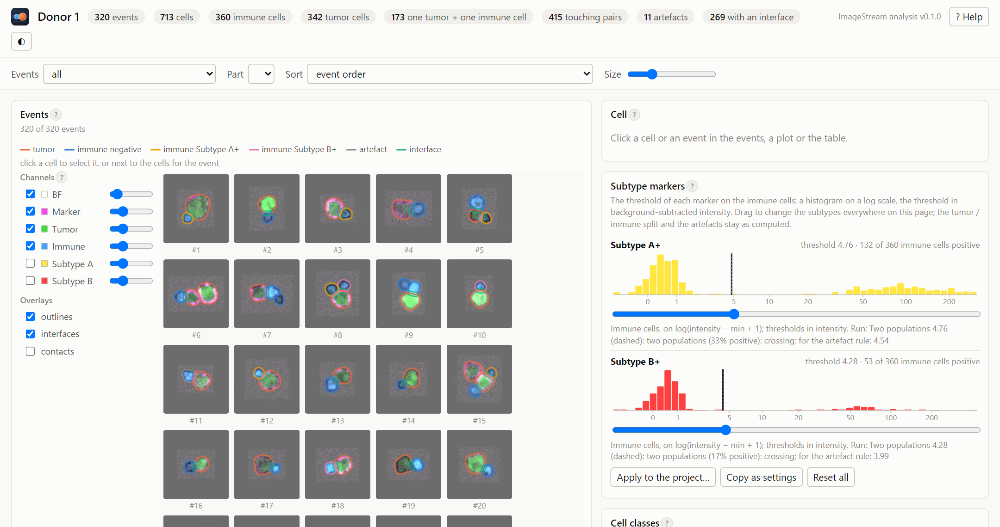
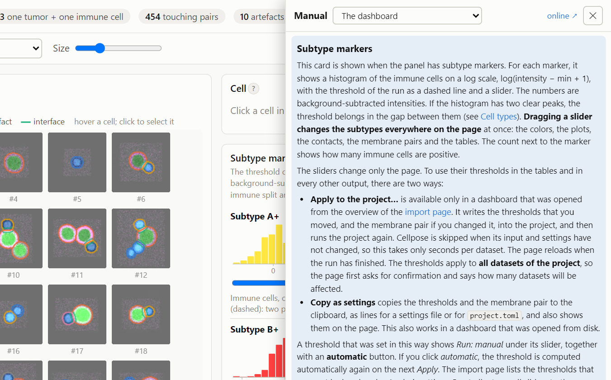
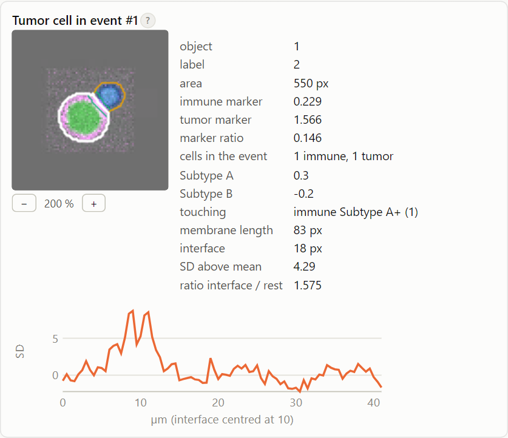
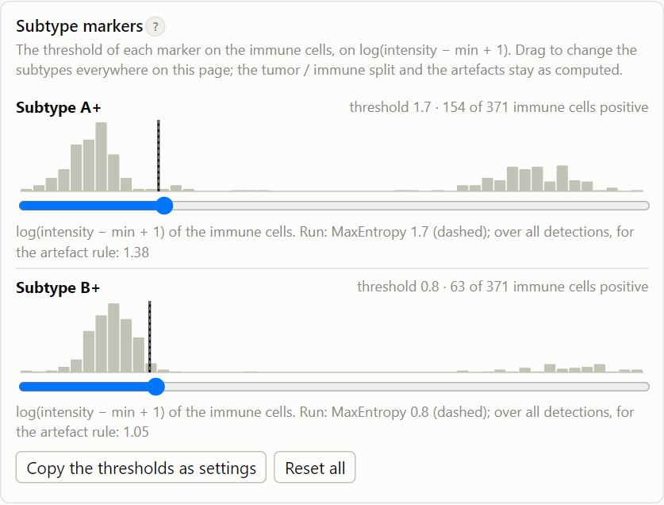
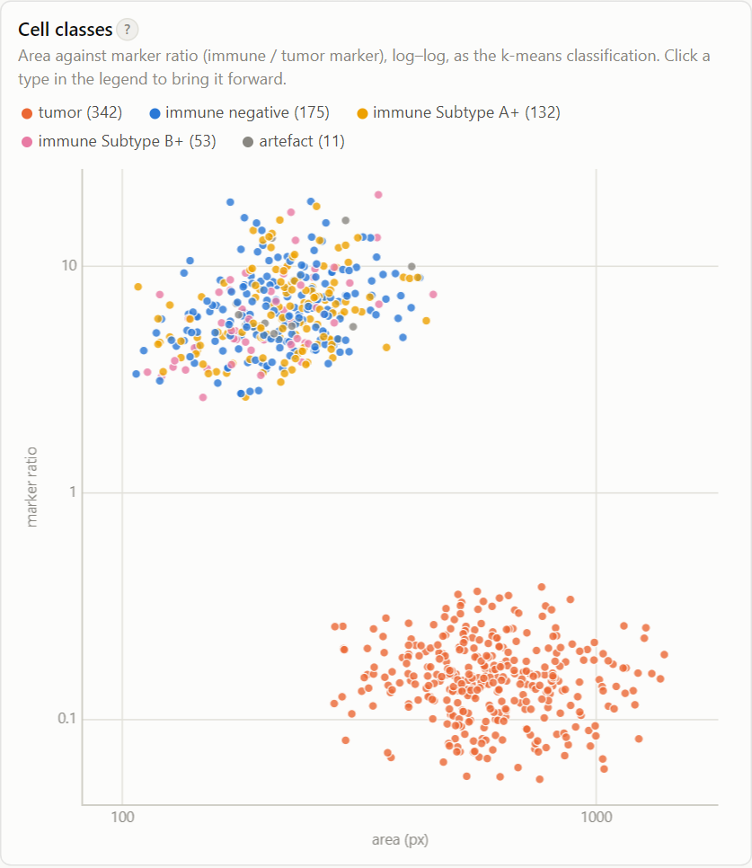
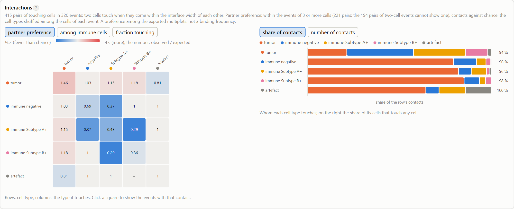
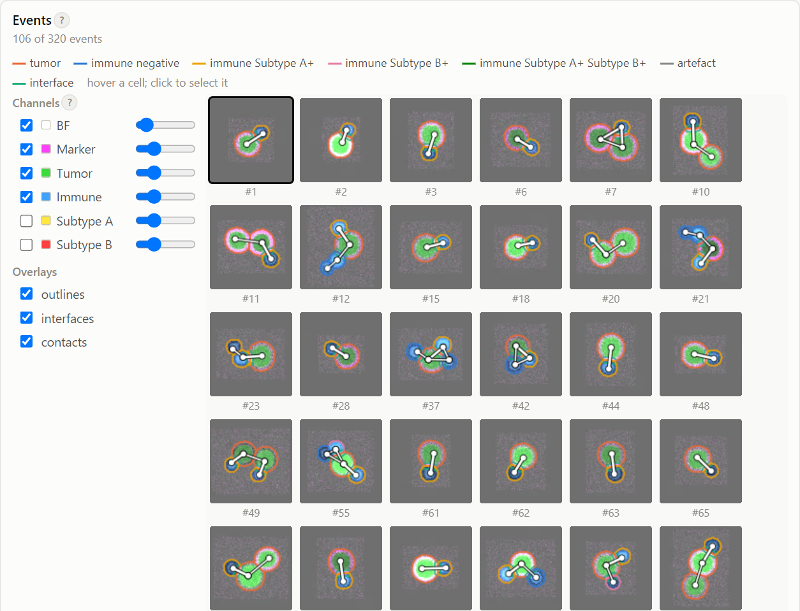
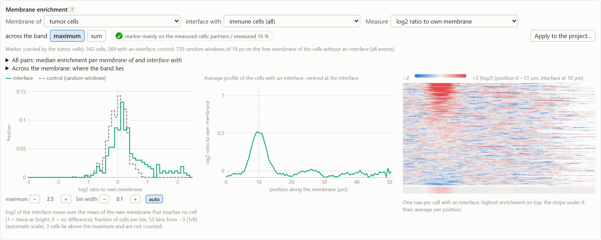

# The dashboard

Every analyzed dataset gets a `dashboard.html` file in its folder. You can open it from the overview of the import
page, or directly from disk by double-clicking it. It needs no server and no internet connection, so you can send the
folder to a colleague. The event images are stored in the `dashboard_files/` folder next to it.

All views on the page are **linked**. When you hover over a cell in the events, in a plot or in a table, it is
highlighted in every view. Clicking a cell selects it and shows it in the *Cell* card. Clicking an event next to its
cells selects the event and shows it in the *Cell* card. Press *Esc* to clear the selection. To select a cell or an event when the page opens, add `#cell=12` or `#event=5` to the address, as in
`dashboard.html#cell=12`; the cell number is its row in the cell table.

The page remembers its view in the browser, separately for each dashboard: the channels and their brightness, the
overlays, the filter, the sort order, the size, the magnification in the *Cell* card, the marker of interest and the
membrane pair of each marker, the scale of the membrane histograms and the open tabs. The next time you open the
dashboard, it shows the same view again.

## Top: counts and filters

The header shows the number of events, cells, cell types, events with one tumor cell and one immune cell, touching
pairs, artefacts and cells with an interface. The filter row below the header applies to every view:

- **Events**: shows all events, the events with immune cells and tumor cells, the events with one tumor cell and one
  immune cell, the events with an interface, or the events with touching cells. When you choose a contact in the
  [interaction matrix](#interactions), a chip for it is added here; click ✕ to remove it.
- **Sort**: sets the order of the events.
- **Size**: sets the size of the event images. You can also hold <kbd>Ctrl</kbd> and scroll over the gallery. Small
  event images show only their event number; hover over one to see its IDEAS object number.

The **?** button after a heading, and the **? Help** button at the top, open the part of this manual that describes
that item in a panel at the side of the page. <kbd>F1</kbd> or <kbd>?</kbd> does the same for the card under the
mouse pointer. The help panel also works offline.

{ width="600" }

## Events

This card shows the events as a gallery. Each cell is outlined in the color of its cell type, and the interfaces are
drawn in aqua. Only the events that are visible on the screen are drawn, so the page stays fast for large datasets.
The selected event has a dark frame and a bold number. The gallery takes the full height of the card, as tall as the
cards on the right.

## Channels and overlays

The column to the left of the gallery controls what is drawn in the event images:

- **Channels**: one row per channel, with a tick box to show or hide the channel and a control for its brightness.
  Double-click the name of a channel to show only that channel. The brightfield channel starts at half brightness,
  underneath the fluorescence channels.
- **Overlays**: the **outlines** of the cells (in the color of their cell type), the **interfaces**, and the
  **contacts**. A contact is drawn as a white line with a dark edge between the centers of two cells that touch.

## Cell

This card shows the selected cell: its event, its measurements, its subtype markers (the value, and whether it is
positive or negative), and the cells it touches. If the membrane analysis was run, the card also shows the membrane
profile of the cell, aligned on the interface. With several markers of interest, the membrane rows and the profile are
those of the marker chosen in the [Membrane enrichment](#membrane-enrichment) card, and the row *marker* names it.

When an event is selected but no cell, the card shows that event: its object number, its cells and their types, the
number of touching pairs, and the marker of interest at the interface and on the rest of the membrane, from the
per-event table (of the marker chosen in the membrane card). You can hover over the cells in the enlarged image and click one to show it.

The **−** and **+** buttons under the image set its magnification: 100 % is one screen pixel per image pixel, and the
steps are 100, 150, 200, 300, 400 and 600 %. The default is 200 %. The page remembers the last magnification.

{ width="420" }

## Subtype markers

This card is shown when the panel has subtype markers. For each marker, it shows a histogram of the immune cells on a
log scale, log(intensity − min + 1), with the threshold of the run as a dashed line and a slider. The bars have the
color of the marker's channel, and the numbers under the histogram are background-subtracted intensities. If the
histogram has two clear peaks, the threshold belongs in the gap between them
(see [Cell types](../analysis/classification.md#immune-subtypes)). **Dragging a slider changes the subtypes everywhere
on the page**: the colors, the plots, the contacts, the membrane pairs and the tables. The count next to the marker
shows how many immune cells are positive.

While you drag, the events, the cell classes and the count follow at once. The contacts, the membrane enrichment and
the tables take longer to compute on large datasets, so they follow when you release the slider, or when it has
stood still for 0.7 s.

{ width="420" }

The sliders change only the page. To use their thresholds in the tables and in every other output, there are two
ways:

- **Apply to the project…** is available only in a dashboard that was opened from the overview of the
  [import page](import-page.md). It writes the thresholds that you moved, and the membrane pair if you changed it, into
  the project, and then runs the project again. Cellpose is skipped when its input and settings have not changed, so
  this takes only seconds per dataset. The page reloads when the run has finished. The thresholds apply to **all
  datasets of the project**, so the page first asks for confirmation and says how many datasets will be affected.
- **Copy as settings** copies the thresholds and the membrane pair to the clipboard, as lines for a settings file or
  for `project.toml`, and also shows them on the page. This also works in a dashboard that was opened from disk.

A threshold that was set in this way shows *Run: manual* under its slider, together with an **automatic** button. If
you click *automatic*, the threshold is computed automatically again on the next *Apply*. The import page lists the
thresholds that were set by hand under *Analysis settings*. *Reset all* returns all sliders to the thresholds of the
run.

??? note "Technical: what the slider changes, and what not"

    The slider applies the new threshold to the immune cells on the page. It does not repeat the clustering into tumor
    cells and immune cells, and the artefacts stay as they were computed, because both would need the whole
    classification to be run again. (The artefact rule uses thresholds over *all* detections; see
    [Cell types](../analysis/classification.md#artefacts).) In the run, a threshold that was set by hand
    (`classification.thresholds`) is used for both the subtypes and the artefact rule.

    A threshold that is applied to the project can therefore change the artefacts too, and with them the numbers of
    the other cells.

## Cell classes

This plot shows the area of each cell against its marker ratio (immune marker / tumor marker), on log–log axes. This
is the space in which k-means separates the tumor cells from the immune cells. Click a cell type in the legend to bring
its points to the front.

{ width="420" }

## Interactions

- **Partner preference** (left): the rows are cell types, and the columns are the cell types they touch. The color and
  the number in each square give the number of observed contacts divided by the number expected by chance, within the
  events with three or more cells. Blue means fewer contacts than expected by chance, and red means more. The
  *fraction touching* option shows instead the share of the row's cells that touch at least one cell of the column's
  type. Hover over a square to see the counts. **Click a square to show only the events with that contact**, with the
  contacts drawn.
- **Among immune cells** (tab): the
  [subset preference](../analysis/interactions.md#subset-preference-which-immune-cells-touch). For each immune subtype,
  it shows whether that subtype is the one that touches the tumor cell (or another subtype) more often than expected
  by chance, in events that offer a choice. A square is colored only where the 95 % interval excludes 1. Hover over a
  square to see the counts and the interval.
- **Share of contacts** (right): for each cell type, which cell types it touches, as a share of its contacts or as
  numbers. On the right, it also shows the share of its cells that touch any other cell.

[Cell contacts](../analysis/interactions.md) explains how contacts and chance are defined, and what they can and
cannot tell you.

{ width="560" }

## Membrane enrichment

This card is shown when the membrane analysis was run. The **Membrane of** and **interface with** menus choose the
pair of cells to compare. Each can be a cell type, an immune subtype, or all immune cells that are positive for a
marker. The page computes the enrichment for the chosen pair immediately. *Apply to the project…* makes it the pair
that is used for the tables (see [Subtype markers](#subtype-markers)).

With two or more markers of interest, a **Marker** menu comes first. It switches the whole card to that marker: the
histograms, the profile, the heatmap, *All pairs*, the badge, the membrane columns of the *Cells* table and the cell
card. Each marker starts with the pair of the run, which is by default the cell type that carries that marker against
the other type, and keeps the pair you choose for it. The line under the menus names the marker and the cell type that
carries it. *Apply to the project…* and *Copy as settings* write the pair of the marker shown only
(`[membrane.pairs.'<marker>']`); the other markers keep theirs. The page remembers the chosen marker.

- **Histogram**: the enrichment at the interface (aqua) of every cell with an interface, compared with random control
  windows on cells without an interface (dashed). The enrichment is expressed in standard deviations above the mean of
  the free membrane, that is, the membrane that touches no other cell. The histograms start at −5 SD. By default the
  scale is automatic: the maximum is the 99th percentile of the interface values or of the control windows, whichever
  is higher, so that one extreme cell does not squeeze the rest into a few bins. The bin width is chosen to give at
  most 60 bins. Use the **−** and **+** buttons under the plot to change the *maximum* or the *bin width*, and
  **auto** to return to the automatic scale. The page redraws the histograms immediately and remembers the scale.
  Values above the maximum are not counted; the note under the plot says how many cells that concerns.
- **Average profile**: the average membrane profile of the cells with an interface, centered on the interface.
- **Heatmap**: one row per cell with an interface, with the strongest enrichment at the top.
- **All pairs** (folded): the median enrichment of every combination of *Membrane of* and *interface with*, with the
  number of cells and the marker check of each pair. Use this table to compare pairs (see
  [The control](../analysis/membrane.md#the-control)). Click a number to show that pair.
- **Measure**: *SD above own membrane* (the default) scores the interface against the cell's own membrane that
  touches no cell. *SD above both membranes* also subtracts the partner's free membrane at every interface position:
  the excess over both membranes, for a marker that the partner carries too. The histograms, the average profile,
  the heatmap, *All pairs*, the cell card and the *Cells* table follow the choice, and the page remembers it. Read
  [the excess over both membranes](../analysis/membrane.md#where-the-marker-is-expressed) before you use it: check it
  first on contacts between cells of the same type.
- **Across the band**: *maximum* (the default, as the macro and the tables) takes the brightest sample across the
  membrane at every position; *sum* adds all samples. At an interface both membranes lie in the band, and only the
  sum adds them up, as *SD above both membranes* assumes. Everything in the card follows the switch; the tables of
  the output folder keep the maximum. The page remembers it.
- **The badge** next to the menus shows where the marker of interest is expressed: on the measured cells, also on
  their partners, on both at a similar level, or hardly on the measured cells at all (gray: not informative). Before
  you trust a result with an amber, red or gray badge, read
  [Membrane enrichment](../analysis/membrane.md#where-the-marker-is-expressed).
  [The control](../analysis/membrane.md#the-control) explains what the control windows can and cannot tell you.

??? note "Technical: the page and the tables"

    The page computes the pair from the membrane profile and the neighbor track of every cell, in the same way as the
    program does for the tables. Only the random control windows differ: the page uses a fixed seed, and the run uses
    an unseeded random generator. Their summaries agree closely. The tables (`Membrane intensity analysis - <marker>.tsv`,
    one per marker of interest) hold the pair of the run: the pair set in the settings, or by default the cell type
    that carries the marker against the other type.

    The per-event measure of the Fiji macro (the marker at the interface against the rest of the membrane, per event)
    is no longer plotted: the pair comparisons supersede it. Its values are still in the *Events* table, in the sort
    *membrane ratio* and in `All cell combinations.tsv`.

## Tables

The *Cells*, *Events* and *Contacts* tables can be sorted by clicking a column header. The rows follow the filters,
and at most 2000 rows are shown; sort the table to see other rows. **Download .tsv** saves the current table with all
its rows, filtered and sorted as on the page, and with the subtypes set by the sliders. The tables of the run itself
are the TSV files in the [output folder](output-folder.md).
