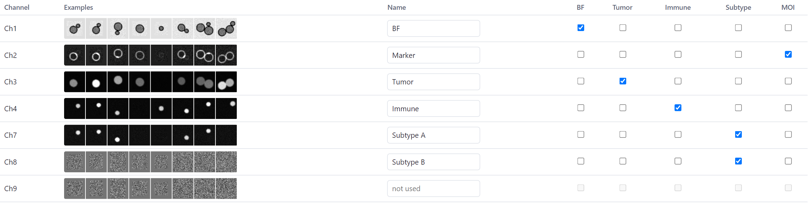

# The import page

The import page (`uv run imagestream`, or `uv run imagestream-cli gui`) sets up a **project**: one or more IDEAS
exports, the names and roles of their channels, and the analysis settings. It runs the analysis and shows the
overview. It is a page in your browser served by the program on your own computer; nothing leaves it.

The page remembers the last project. A second start opens the running page again. **Quit** (top right) saves the
project and stops the program; otherwise it stops by itself 15 minutes after the page was closed (never during a run).

The **?** button behind a step or a group of settings, and the **? Help** button at the top, open the part of this
manual about it in a panel at the side; <kbd>F1</kbd> or <kbd>?</kbd> does the same for the step under the mouse.

## 1. Project

The output folder of the project. *Browse…* chooses it, *Open project…* opens an existing `project.toml`, *Save*
writes the project file without running. The results of a dataset go to `<project>/<experiment>/<dataset>/`.

## 2. IDEAS exports

*Add zip files…* (or paste a path and *Add*) adds exports. For each export:

- **Pixel size**: 20×, 40× or 60× (1, 0.5 or 0.33 µm per pixel), or *other…*. IDEAS files do not contain it. Check it
  for your instrument: these are the nominal values.
- **Datasets**: every first-level folder of the zip is a dataset. *Use* includes it; *Objects* counts the objects,
  *Complete* those that have every needed channel (the others are left out). *Experiment* groups datasets: see
  [Pools](#pools) below.
- **Channels**: the example images show a few objects of each channel. Give every needed channel a **name**; tick its
  **role**:

    | Role | Meaning | How many |
    |---|---|---|
    | **BF** | brightfield | one |
    | **Tumor** | the tumor-cell marker | one |
    | **Immune** | an immune-cell marker; several are summed | one or more |
    | **Subtype** | an immune subtype marker: positive or negative per cell | none or more |
    | **MOI** | the marker of interest, measured along the membrane | one |

    A channel can have two roles (for example a subtype marker that is also the marker of interest).

*Copy setup to all* gives the other exports the same pixel size and channel names. *Remove* removes the export from
the project (not from disk).

??? note "Technical: roles go with the name"

    The roles are stored once for the project, by marker name (`[channels]` in `project.toml`), and every export only
    maps its channel numbers to names. So exports of the same panel whose channels are numbered differently (another
    instrument setup, another IDEAS template) need no other roles: only the right names. A tick box is greyed out
    until the channel has a name. Renaming a channel takes its roles along, unless another export still uses the
    old name.

    Projects written before November 2026 stored the roles per export, by number. On opening, they become roles by
    name when all exports agree; otherwise each export keeps its own numbers (shown under its channel table).

## 3. Analysis settings

Used for all datasets of the project. The most important:

- **Tumor / immune markers**: *nuclear* or *membrane*: where the tumor and immune markers stain, which decides how the
  image for Cellpose is made (see [Segmentation](../analysis/segmentation.md)).
- **Marker of interest expressed in**: the cell type that carries the marker of interest. The membrane enrichment is
  measured on these cells (see [Membrane enrichment](../analysis/membrane.md)).
- **Python with Cellpose**, **Model**, **Cell diameter (px)**: the segmentation.
- **Classify together**, **Threshold of the subtype markers**, **Artefact**: the [cell types](../analysis/classification.md).
- **Membrane profiles and enrichment**, **Membrane of**, **Interface with**: the [membrane enrichment](../analysis/membrane.md).

[All settings](../reference/settings.md) lists every setting with its default.

### Pools

*Classify together (one set of thresholds)*: **experiment** (the default) classifies the cells of all datasets with
the same experiment label together, so that "positive for a marker" means the same in every dataset of the
experiment; **dataset** classifies each dataset on its own. See
[Cell types](../analysis/classification.md#several-datasets-pools).

## 4. Run

The list above *Run all datasets* names what is missing (an output folder, a pixel size, a channel for a role, …); the
button works when the list is empty. The run saves the project first. The log follows the run; *Stop* ends it. A
dataset that fails is logged and the others go on.

## 5. Overview

One row per analysed dataset, with a link to its [dashboard](dashboard.md) and its folder. See
[The project overview](overview.md).
