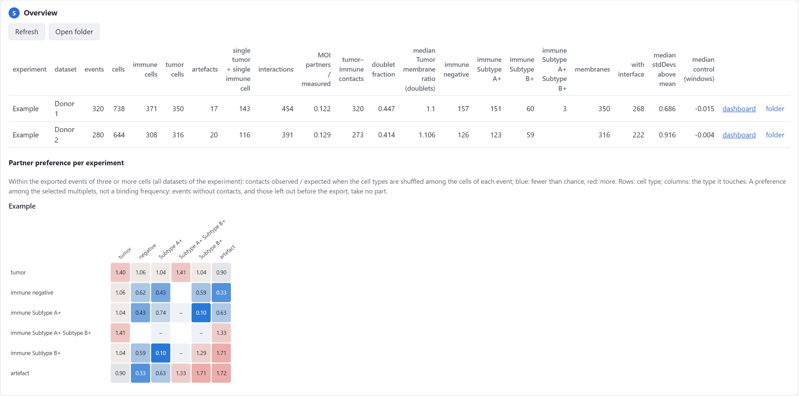

# The project overview

The last step of the import page shows one row per analysed dataset, and below it the partner preference of every
experiment. The same is written to `overview.tsv` and `interactions.tsv` in the project folder.

## The table

One row per dataset; *dashboard* opens the dataset's dashboard, *folder* its folder. A dataset that failed shows its
error instead. Hovering a column header shows what it means:

| Column | Meaning |
|---|---|
| *events*, *cells* | the events analysed; the cells after the clean-up, artefacts included |
| *immune cells*, *tumor cells*, *artefacts* | the cell types (see [Cell types](../analysis/classification.md)) |
| *single tumor + single immune cell* | events with exactly one tumor and one immune cell that touch |
| *interactions* | pairs of touching cells, of any types |
| *MOI partners / measured* | the marker check (see [Membrane enrichment](../analysis/membrane.md#where-the-marker-is-expressed)); empty without a marker of interest |
| *tumor–immune contacts* | pairs of a tumor and an immune cell that touch |
| *doublet fraction* | *single tumor + single immune cell* divided by *events* |
| *median Tumor (or Immune) membrane ratio (doublets)* | in those events: the mean marker of interest in the measured cell's membrane band at the interface, over the rest of its band (the macro's ratio; all immune cells, whatever the membrane pair) |
| *immune negative*, *immune A+*, *immune A+ B+*, … | immune cells with exactly that combination of positive subtype markers (*immune A+* is negative for the other markers); 0 where a dataset has none |
| *membrane pair* | the pair of the enrichment columns that follow: *Membrane of* … *with* … |
| *membranes*, *with interface* | the measured cells of that pair, and those that touch a partner |
| *median stdDevs above mean*, *median control (windows)* | the median enrichment of the cells with an interface, and of the control windows |

The enrichment columns follow the membrane pair of the project: after *Apply to the project…* with another pair in a
dashboard, they describe that pair. Note the pair with the numbers.

## Partner preference per experiment

One matrix per experiment, for all its datasets together: contacts observed ÷ expected by chance, in the events of
three or more cells (blue: fewer than chance, red: more). Hover a square for the counts. Comparing the matrices of
experiments shows whether a preference holds across samples. How it is computed, and what it does not measure, is in
[Cell contacts](../analysis/interactions.md).

??? note "Technical: summing over datasets"

    `interactions.tsv` holds every dataset's contact table, and per experiment a row "(all)": the contacts, the cells
    touching and the expected contacts summed over its datasets, and observed / expected computed from those sums
    (not the mean of the datasets' ratios, which would weigh a small dataset as much as a large one).
