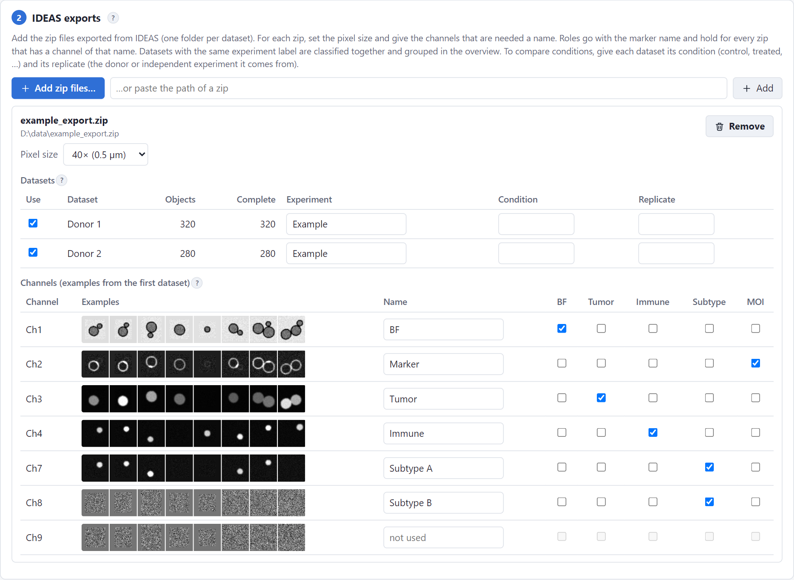
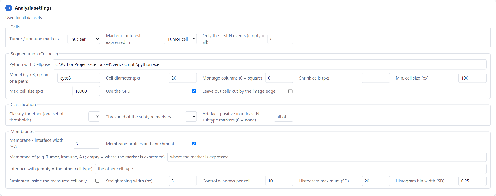
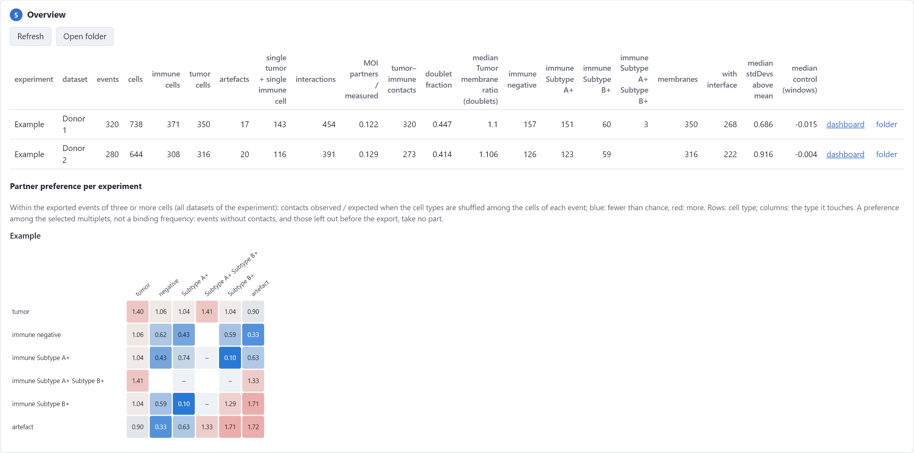
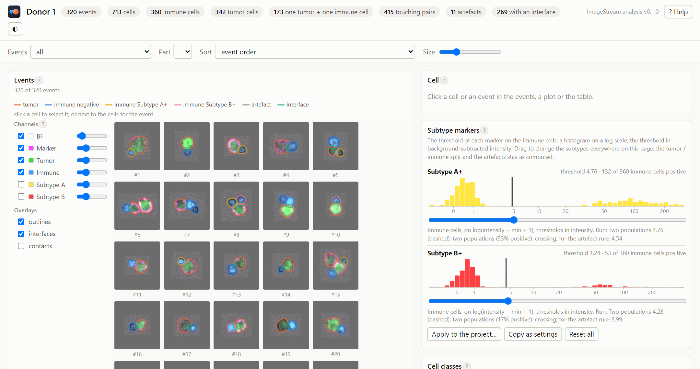

# Your first analysis

This walk-through analyzes the example data. The example is a synthetic IDEAS export with two datasets ("Donor 1"
and "Donor 2") of tumor cells and immune cells, with two immune subtype markers and a marker of interest on the tumor
cells. The data were generated by a script, so that the true cell types are known; they are not measurements.

## 1. Get the example

Download `example_export.zip` from the
[example-data release](https://github.com/BioImaging-NKI/ImageStreamAnalysis/releases/tag/example-data) and put it in
a folder of your own, for example `D:\data`. The zip is an export in the form that IDEAS writes: one folder per
dataset, and one TIFF file per object and channel (`<object>_Ch<N>.ome.tif`).

## 2. Open the import page

```powershell
uv run imagestream
```

The import page opens in your browser. It has five steps, which you work through from top to bottom.

**Step 1, Project.** Choose an empty folder for the results, for example `D:\data\example project`. The project file
(`project.toml`) and all results are saved in this folder.

## 3. Add the export and name the channels

**Step 2, IDEAS exports.** Click *Add zip files…* and choose `example_export.zip`. The page reads the zip and shows
its datasets and channels, with a few example objects for each channel to help you recognize it.



1. **Pixel size**: choose *40× (0.5 µm)*. IDEAS files do not contain the pixel size, so you have to set it.
2. **Datasets**: both datasets are ticked. The *Experiment* label groups datasets: datasets with the same label are
   classified together and shown together in the overview. Here, both are labeled *Example*.
3. **Channels**: type a name for every channel that is needed, and tick its role:

    | Channel | Name | Role |
    |---|---|---|
    | Ch1 | BF | BF (brightfield) |
    | Ch2 | Marker | MOI (marker of interest) |
    | Ch3 | Tumor | Tumor |
    | Ch4 | Immune | Immune |
    | Ch7 | Subtype A | Subtype |
    | Ch8 | Subtype B | Subtype |

    Ch9 is not needed. Leave it without a name, and it will not be loaded.

Roles are linked to the channel *name*, not to its number. A second export of the same panel therefore only needs the
same names, even if its channels are numbered differently. [The import page](../guide/import-page.md) describes every
step in detail.

## 4. Settings

**Step 3, Analysis settings.** For the example, change these settings:

- *Marker of interest expressed in*: **Tumor cell** (the marker is on the membrane of the tumor cells);
- *Cell diameter (px)*: **20**;
- *Membrane profiles and enrichment*: **on**.

Leave the other settings as they are. If Cellpose is installed in a separate environment, fill in *Python with
Cellpose* (see [Installation](install.md#3-cellpose)).



## 5. Run

**Step 4, Run.** The list above the button shows what is still missing, if anything. Click *Run all datasets*. The
log shows the progress. First every dataset is segmented and measured, then the datasets of each experiment are
classified together, and finally the analysis of every dataset is completed. With a GPU, the example takes about a
minute.

## 6. The overview

**Step 5, Overview.** The overview has one row per dataset. Each row shows the number of cells and of each cell type,
the contacts and the membrane results, with a link to the dashboard of the dataset. Below the table, the partner
preference of each experiment is shown.



## 7. The dashboard

Click *dashboard* in the row of Donor 1. The [dashboard](../guide/dashboard.md) shows every event, with each cell
outlined in the color of its cell type. All results on the page are linked: when you hover over or click a cell
anywhere, it is highlighted in every view.



Things to try:

- **Subtype markers**: drag the threshold of *Subtype A+* and watch how the subtypes change everywhere.
- **Interactions**: click a square of the matrix, for example *tumor* × *Subtype A+*, to show only the events with
  that contact. Tick *contacts* to draw the contacts in the event images.
- **Membrane enrichment**: under *interface with*, choose **immune cells Subtype A+**. In the example, the marker of
  interest gathers at the contacts with these cells, but not at the contacts with the other cells.

The tables and files that the run writes are described in [The output folder](../guide/output-folder.md).
